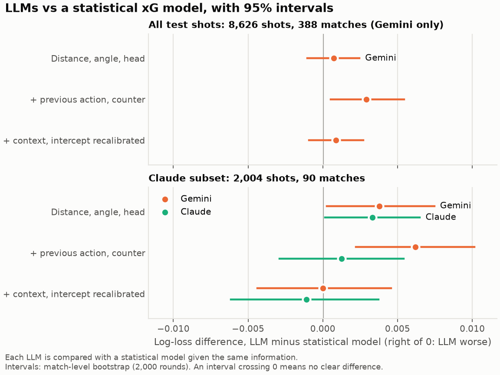

# Claude Opus 5.5 を足して、同じシュートで Gemini・統計モデルと比べる（2026-11-15）

決めごとは [decisions/0009](../decisions/0009-add-claude.md)。テストのシュートから試合単位で選んだ 2,004本（90試合・ゴール 245本）を、Claude Opus 5.5（Anthropic の API、考える量 `low`、1回に 50本）に、Gemini と同じ説明・同じ情報で答えさせた。3つの情報と広い情報（直前のプレーの組とカウンター。decisions/0007）の両方。

- Claude の答え: `data/llm_runs/claude/opus_low.jsonl`・`opus_low_context.jsonl`、確率は `data/xg_claude.csv`・`data/xg_claude_context.csv`。41回ずつ・2,004本すべてに答えがあり、形の崩れも断りも 0
- 費用: 3つの情報 $1.01（入力 10.9万・出力 2.9万トークン）、広い情報 $1.20（入力 15.9万・出力 2.9万）。合わせて $2.21。時間は 260秒ずつ
- 出力は、50本の回がどれも 711 トークン、最後の 4本の回が 67 トークンだった。考える部分は使わず、答えの JSON だけを出したと読める（推定）
- 作り直し方: `mise run llm-claude` → `mise run llm-claude-context`（答えのファイルがあれば API は呼ばない）→ `mise run compare-claude`

## まとめ

- **3つの情報では、Claude と Gemini は見分けられない**（ログ損失の差 −0.0005、95% の幅 −0.0038〜+0.0028。確率の相関 0.979）。Claude は、統計モデルより少し悪い（Claude − 統計モデルのログ損失 +0.0033、幅 +0.0002〜+0.0065）。Gemini − 統計モデルも、この 2,004本では少し悪い（+0.0038、幅 +0.0003〜+0.0075。テスト全体では見分けられなかった。`llm-test.md`）。この差の幅は、README の図を作るときに出した（下の「まとめの図」）
- **広い情報では、Claude のほうが Gemini よりよい**（ログ損失の差 −0.0049、幅 −0.0096〜−0.0004）。Claude は広い情報でよくなり（3つ → 広い: −0.0027、幅 −0.0055〜−0.0000。ぎりぎり）、Gemini はよくならなかった（テスト全体の結果と同じ。`llm-context.md`）
- **広い情報の Claude と統計モデルは、見分けられない**（ログ損失の差 +0.0013、幅 −0.0029〜+0.0054）。高さを直すと −0.0011（幅 −0.0061〜+0.0037）で、数字の上では統計モデルより小さいが、これも見分けられない
- **Claude も確率を低めに出す**。確率の平均は 0.0995（3つ）・0.1008（広い）で、この 2,004本の実際の率 0.1223 より低い。Gemini（0.0963・0.0907）よりは、少し実際に近い

## まとめの図

どの比べも、同じ情報を渡した統計モデルとの、ログ損失の差と 95% の幅（`mise run summary-figure`。2026-11-15 に、README に載せるために作った）。この 2,004本での Gemini − 統計モデルは、図を作るときにはじめて出した。

| この 2,004本 | 3つの情報 | 広い情報 | 広い情報・高さを直す |
| --- | --- | --- | --- |
| Gemini − 統計モデル | +0.0038（+0.0003〜+0.0075） | +0.0062（+0.0022〜+0.0101） | +0.0000（−0.0044〜+0.0046） |
| Claude − 統計モデル | +0.0033（+0.0002〜+0.0065） | +0.0013（−0.0029〜+0.0054） | −0.0011（−0.0061〜+0.0037） |

## 物差し（同じ 2,004本）

| モデル | ログ損失 | ブライアスコア | AUC | 確率の平均 |
| --- | --- | --- | --- | --- |
| 統計モデル（3つ） | 0.2961 | 0.0878 | 0.8175 | 0.1083 |
| Gemini（3つ） | 0.2999 | 0.0886 | 0.8149 | 0.0963 |
| Claude（3つ） | 0.2994 | 0.0889 | 0.8153 | 0.0995 |
| 統計モデル（広い） | 0.2955 | 0.0874 | 0.8146 | 0.1081 |
| Gemini（広い） | 0.3017 | 0.0889 | 0.8133 | 0.0907 |
| Claude（広い） | 0.2967 | 0.0880 | 0.8187 | 0.1008 |
| Gemini（3つ）・高さを直す | 0.2961 | 0.0872 | 0.8138 | 0.1226 |
| Claude（3つ）・高さを直す | 0.2967 | 0.0876 | 0.8142 | 0.1226 |
| Gemini（広い）・高さを直す | 0.2955 | 0.0868 | 0.8124 | 0.1226 |
| Claude（広い）・高さを直す | 0.2944 | 0.0868 | 0.8174 | 0.1225 |

この 2,004本のゴールの率は 0.1223 で、テスト全体（0.1042）より高い。物差しの値は、テスト全体の表（`llm-test.md`・`llm-context.md`）とは並べられない。高さの直しは、decisions/0008 と同じく、この 2,004本の中で試合単位の 5分割で学んだ。

## 確率の相関

| | 3つの情報 | 広い情報 |
| --- | --- | --- |
| Claude と Gemini | 0.979 | 0.964 |
| Claude と統計モデル | 0.979 | 0.964 |
| Gemini と統計モデル | 0.981 | 0.976 |

小数 5桁では、Claude と Gemini が 0.97861・0.96426、Claude と統計モデルが 0.97890・0.96416 で、表で同じに見えるのは四捨五入のため。

## 差と 95% の幅（試合単位のブートストラップ 2,000回）

ログ損失・ブライアスコアはマイナス、AUC はプラスなら、後ろ（左側）のモデルがよい。

| 比べるもの | 物差し | 差 | 95% の幅 |
| --- | --- | --- | --- |
| Claude（3つ） − Gemini（3つ） | ログ損失 | −0.0005 | −0.0038〜+0.0028 |
| | ブライアスコア | +0.0003 | −0.0008〜+0.0013 |
| | AUC | +0.0004 | −0.0063〜+0.0075 |
| Claude（3つ） − 統計モデル（3つ） | ログ損失 | +0.0033 | +0.0002〜+0.0065 |
| | ブライアスコア | +0.0010 | +0.0002〜+0.0018 |
| | AUC | −0.0022 | −0.0095〜+0.0049 |
| Claude（広い） − Gemini（広い） | ログ損失 | −0.0049 | −0.0096〜−0.0004 |
| | ブライアスコア | −0.0008 | −0.0021〜+0.0004 |
| | AUC | +0.0054 | −0.0030〜+0.0142 |
| Claude（広い） − 統計モデル（広い） | ログ損失 | +0.0013 | −0.0029〜+0.0054 |
| | ブライアスコア | +0.0006 | −0.0005〜+0.0018 |
| | AUC | +0.0041 | −0.0063〜+0.0138 |
| Claude（広い） − Claude（3つ） | ログ損失 | −0.0027 | −0.0055〜−0.0000 |
| | ブライアスコア | −0.0008 | −0.0017〜+0.0000 |
| | AUC | +0.0034 | −0.0019〜+0.0088 |
| Claude（3つ）・高さを直す − Gemini（3つ）・高さを直す | ログ損失 | +0.0007 | −0.0028〜+0.0039 |
| | ブライアスコア | +0.0004 | −0.0008〜+0.0015 |
| | AUC | +0.0004 | −0.0064〜+0.0074 |
| Claude（広い）・高さを直す − 統計モデル（広い） | ログ損失 | −0.0011 | −0.0061〜+0.0037 |
| | ブライアスコア | −0.0006 | −0.0019〜+0.0006 |
| | AUC | +0.0027 | −0.0076〜+0.0123 |

## 組ごとの、実際の率と確率の平均（広い情報）

| 組 | 本数 | 実際の率 | 統計モデル | Gemini | Claude |
| --- | --- | --- | --- | --- | --- |
| pass | 528 | 0.087 | 0.075 | 0.059 | 0.063 |
| through_ball | 86 | 0.198 | 0.194 | 0.166 | 0.163 |
| cross | 281 | 0.178 | 0.155 | 0.137 | 0.153 |
| corner | 78 | 0.077 | 0.067 | 0.071 | 0.101 |
| rebound | 78 | 0.321 | 0.290 | 0.241 | 0.238 |
| lofted_pass | 98 | 0.133 | 0.130 | 0.088 | 0.099 |
| aerial_duel | 256 | 0.141 | 0.095 | 0.096 | 0.124 |
| dribble_duel | 597 | 0.087 | 0.087 | 0.068 | 0.073 |
| other | 2 | 0.000 | 0.037 | 0.013 | 0.017 |

## 読み方

- 3つの情報（距離・角度・頭か足か）だけなら、2つの LLM の「サッカーの常識」はほぼ同じ答えを出す（相関 0.979、物差しも見分けられない）。「LLM は、この 3つから、データで作った xG に近い順位付けができるが、確率は低めに出す」は、Gemini 1つだけの話ではなさそう（推定）
- 広い情報で差が出た。Claude は、空中戦のあと（実際 0.141）を 0.124 まで上げ、クロスのあとも統計モデルに近い（0.153）。Gemini は、どちらも低めのまま（0.096・0.137）。逆に、Claude はコーナーのあと（実際 0.077）を 0.101 と高く見た
- こぼれ球のあと（実際 0.321）は、2つの LLM とも低い（0.24 前後）。決まりやすさの大きさを、常識では見積もりにくいところと読める（推定）

## 読み方の注意

- 2,004本・90試合で、テスト全体（8,626本・388試合）の 4分の1。差の幅はテスト全体の比べより広い。Claude と Gemini の広い情報の差は、幅の端が −0.0004 で 0 に近い
- この 2,004本は、ゴールの率が 0.1223 で、テスト全体より高い（試合の選ばれ方による）
- Claude の答えは 1回分。Gemini のように 2回聞いたときの揺れは、まだ見ていない
- 単価は Anthropic の価格表の写し（2026-10-06 時点）で、今の単価はまだ確かめていない
