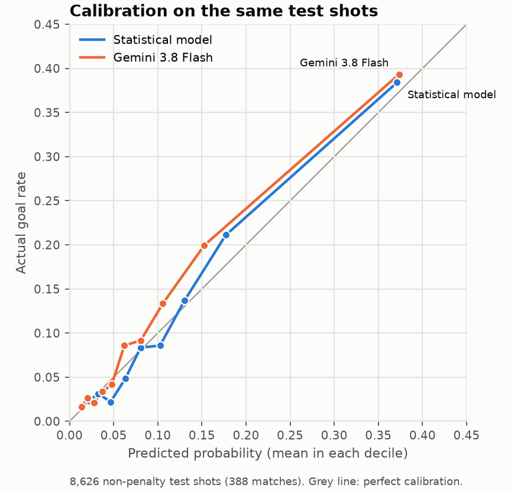
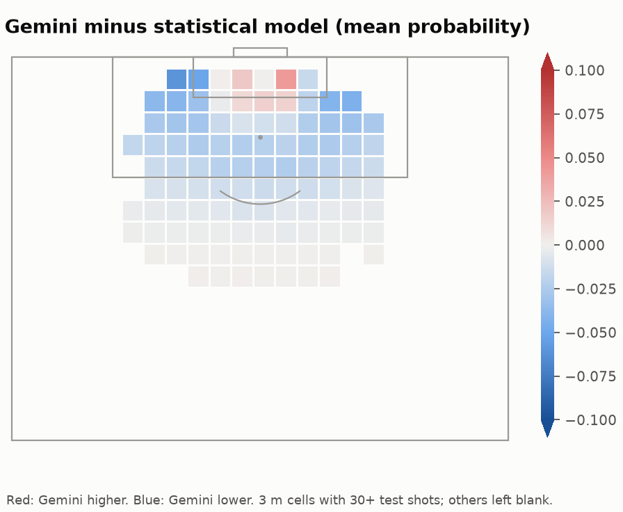

# テストの 8,626本で、Gemini と統計モデルを比べる（2026-11-08）

決めごとは [decisions/0006](../decisions/0006-compare-with-llm.md)、試しは [llm-trial.md](./llm-trial.md)。最初の xG と同じテストのシュート（試合単位の 2割、388試合）を、Gemini 3.8 Flash（Vertex AI、考える量 LOW、1回に 50本）に、統計モデルと同じ 3つの情報（ゴールまでの距離 m・ゴールの見える角度（度）・頭か足か）だけで答えさせた。統計モデルは同じシュートの交差検証の xG（`data/xg_stat.csv`）。

- Gemini の答え: `data/llm_runs/test/low.jsonl`（1回ごと）と `data/xg_gemini.csv`（`shot_id, xg`）。173回・8,626本すべてに答えがあり、形の崩れは 0
- 費用 $0.85（入力 35.8万・出力 15.6万トークン、思考 0）、時間 21分（1回 7秒ほど）
- 作り直し方: `mise run llm-test`（答えのファイルがあれば API は呼ばない）→ `mise run compare-llm`（表と図）

## まとめ

- **当たり方の差は見分けられない**。差（Gemini − 統計モデル）の 95% の幅は、3つの物差しとも 0 をまたぐ（ログ損失 +0.0007、幅 −0.0010〜+0.0024。AUC −0.0007、幅 −0.0043〜+0.0026）。距離・角度・頭か足かの 3つだけを渡すと、Gemini の「サッカーの常識」は、データから作った xG と同じくらい当たる。500本の試しで「Gemini が少し上かも」と見えたのは、偶然の範囲だった
- **答え方はよく似ている**（確率の相関 0.979）。距離と角度から確率を出す形は、ほとんど同じ
- **ただし、Gemini は確率を低めに出す**。確率の平均は 0.092 で、実際の率 0.104 の 0.88倍。当たり具合の図でも、Gemini の線はどの段階でも対角線の上（実際より低め）にある
  - いちばん低いのは 12〜18m（ペナルティエリアの端あたり）で、実際 0.107 に対して 0.081（0.76倍）。差の地図では、ペナルティエリアの左右の端が青い
  - 逆に、ゴールの正面の 6m 以内では少し高め（実際 0.551 に対して 0.542 で、統計モデルの 0.520 より高い。地図ではゴールエリアの中が赤い）
- 順位付け（AUC）は同じなので、Gemini の確率に「全体を少し上げる」直しをかけると、統計モデルに近づく見込み（推定。まだ試していない）

## 図

## 読み方の注意

- 1回の分け方のテスト（388試合）での比べ。差の幅は、試合を選び直すブートストラップで出した
- 渡したのは 3つの情報だけ。直前のプレーやカウンターを足すと、Gemini の常識が生きる余地が広がる（decisions/0006 の次の段階）
- Gemini の答えは、同じシュートでも聞くたびに少し揺れる（500本の試しで、2回の相関 0.986・差の平均 0.01）。この比べは 1回分の答え
- 単価は 2026-11-03 に Step2 で確かめた値で、今の単価はまだ確かめていない

## 出力

`mise run compare-llm` の出力をそのまま貼ったもの。

- 8626本・388試合・ゴール 899（0.1042）
- Gemini と統計モデルの確率の相関: 0.979

| モデル | ログ損失 | ブライアスコア | AUC | 確率の平均 |
| --- | --- | --- | --- | --- |
| 平均の率だけ | 0.3343 | 0.0934 | 0.5000 | 0.1042 |
| 統計モデル（交差検証の xG） | 0.2765 | 0.0793 | 0.7945 | 0.1039 |
| Gemini 3.8 Flash（LOW） | 0.2773 | 0.0796 | 0.7938 | 0.0921 |

差（Gemini − 統計モデル）と 95% の幅（試合単位のブートストラップ 2000回）

| 物差し | 差 | 95% の幅 | 読み方 |
| --- | --- | --- | --- |
| ログ損失 | +0.0007 | -0.0010〜+0.0024 | マイナスなら Gemini がよい |
| ブライアスコア | +0.0003 | -0.0001〜+0.0007 | マイナスなら Gemini がよい |
| AUC | -0.0007 | -0.0043〜+0.0026 | プラスなら Gemini がよい |

距離ごとの確率の平均と、実際のゴールの率

| 距離（m） | 本数 | 実際の率 | 統計モデル | Gemini |
| --- | --- | --- | --- | --- |
| 0〜6 | 265 | 0.551 | 0.520 | 0.542 |
| 6〜12 | 1704 | 0.208 | 0.198 | 0.186 |
| 12〜18 | 2634 | 0.107 | 0.107 | 0.081 |
| 18〜24 | 1572 | 0.041 | 0.055 | 0.044 |
| 24 以上 | 2451 | 0.021 | 0.022 | 0.021 |
