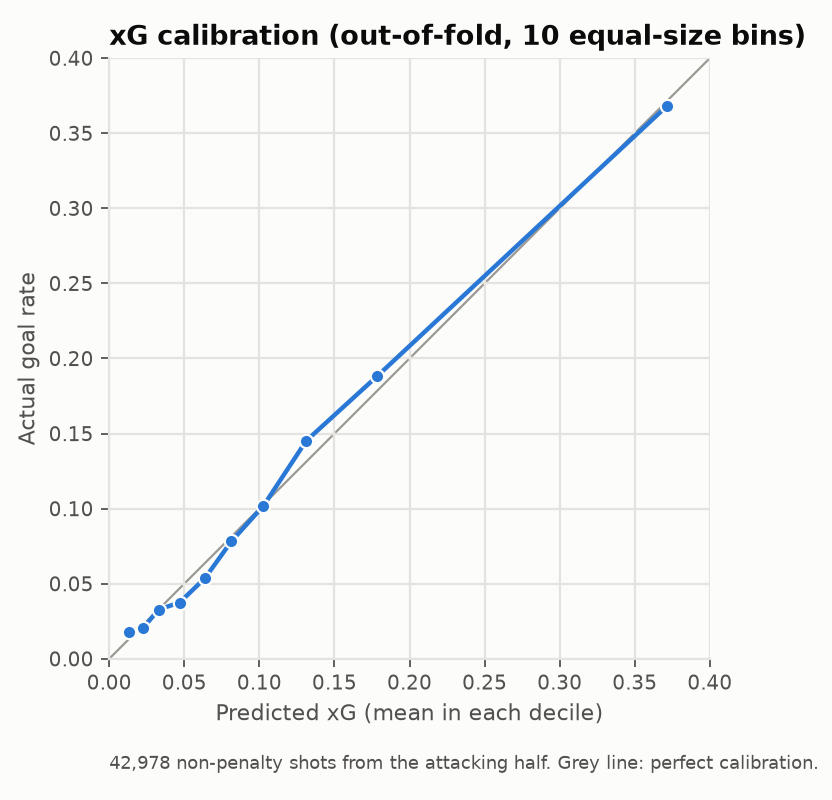
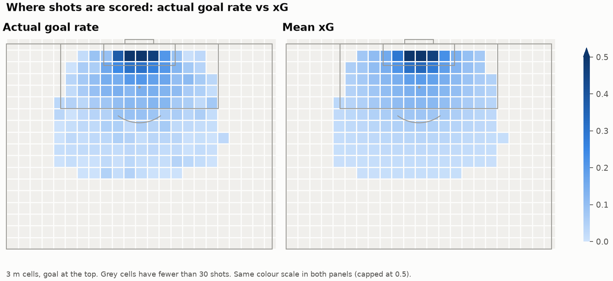
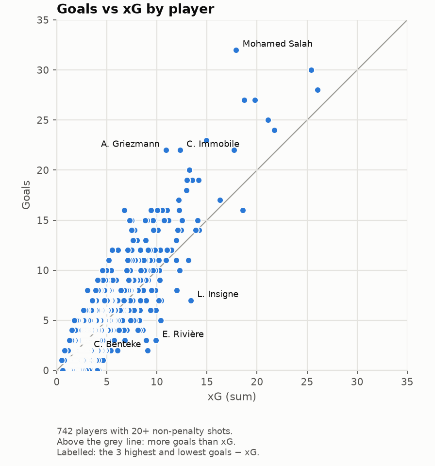
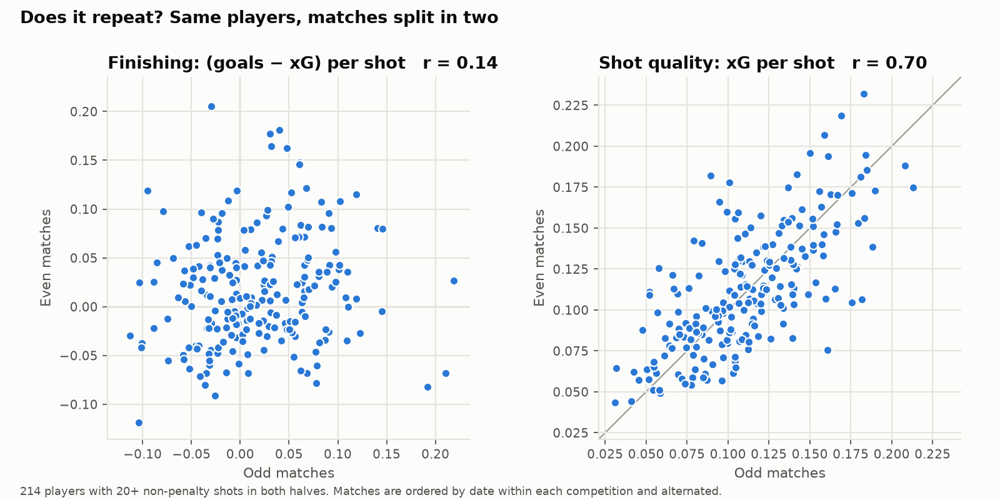

# xG の集計と、モデルの確かめ（2026-11-08）

決めごとは [decisions/0005](../decisions/0005-cv-aggregates-figures.md)。xG は試合単位の 5分割の交差検証で出したもの（`data/xg_stat.csv`、どのシュートもその試合を学習に使っていないモデルの値）。対象はモデルと同じ普通のシュートで、**PK・直接フリーキック・自陣からのシュートを除く**。ゴールもこの範囲で数えるので、公式のゴール数とは合わない。

作り直し方: `mise run xg-cv`（xG）→ `mise run aggregate`（集計の CSV と下の「出力」）→ `mise run figures`（図）。

## まとめ

- **モデルは全体ではよく合っている**: xG の合計 4,489.1 に対して実際のゴール 4,488。確率の当たり具合（10段階）は、0.05〜0.06 あたりでやや高く出し（出した 0.047 に対して実際 0.037、0.064 に対して 0.054）、0.13〜0.18 でやや低く出している（0.131 に対して 0.145、0.179 に対して 0.188）。0.10 の段階はほぼぴったり（0.103 に対して 0.102）。場所ごとの地図でも、実際の率と xG はよく似た形をしている
- **いい場所に入る力は続くが、同じ場所から多く決める力はほとんど続かない**: 試合を 2つに分けると、**打つ場所のよさ**（1本あたりの xG。いい場所に入って打てる力）は相関 0.70 でよく続く。一方、**同じ場所から xG より多く決める力**（1本あたりのゴール − xG。このリポジトリで「決定力」と呼ぶもの）は 0.14 しか続かない（95% の幅 0.004〜0.267、214人）。選手ごとの「ゴール − xG」の大きな差は、1シーズンでは目立っても、その多くは次も続くとは言えない（推定）
  - 「その場所にいることも点を取る力だ」という見方は、上の「打つ場所のよさ」にあたる。この集計は、それを選手の力として続くものと読んでいる
  - 相関 0.14 は 0 より少し上なので、続く部分が少しはありそう。1人あたりの本数が少ない（半分ずつで 20本以上）と、本物の差があっても相関は低めに出る
  - この xG は距離・角度・頭か体かだけで作っているので、「ゴール − xG」には、シュートの技術のほかに、データにない状況（守備の寄せ・パスの質・キーパーの位置など）も混ざる（2026-11-15 に書き直した。前は「多くは偶然と読める」と書いていた）
- **なので、選手の表は「打つ場所のよさ」と「本数」を主に読む**: たとえば、xG の多い選手の上位は、本数が多いか、1本あたりの xG が高い（ゴールの近くで打っている）選手。ゴール − xG の大きい選手（Salah +14.1 など）は、1シーズンの結果としては目立つが、次も続くかはこのデータからは言えない

## 図

### モデルの確かめ

### 選手

## 読み方の注意

- 1シーズン分（ワールドカップ・ユーロは大会 1つ分）なので、選手ごとの本数は多くても 200本ほど。1本あたりの差が 0.05 でも、200本で 10ゴールの差になる。「ゴール − xG」は必ず本数と並べて読む
- 相関は、両方の組で 20本以上打った 214人だけで数えた。本数の多い選手（前線の選手）に偏る
- 大会ごとの差（スペイン +32.4、イタリア −32.0 など）は、モデルを全大会まとめて作ったため。大会ごとの決まり方の違い（守備の強さなど）か、記録の付け方の違いかは、まだ見ていない
- 名前は `players.json` の `shortName`。1人だけ名前がなく、`(id …)` と出る

## 出力

`mise run aggregate` の出力をそのまま貼ったもの。全部の行は `data/aggregates/` の CSV にある。

### 集計（PK・直接フリーキック・自陣を除く普通のシュート）

- 42978本・ゴール 4488・xG 4489.1
- 選手 2375人・チーム 142・大会 7

#### 大会ごと

| 名前 | 本数 | ゴール | xG | ゴール − xG | 1本あたりの xG |
| --- | --- | --- | --- | --- | --- |
| England | 8443 | 913 | 920.7 | -7.7 | 0.109 |
| Italy | 8782 | 853 | 885.0 | -32.0 | 0.101 |
| Spain | 7959 | 883 | 850.6 | +32.4 | 0.107 |
| France | 8311 | 873 | 848.8 | +24.2 | 0.102 |
| Germany | 6875 | 745 | 743.0 | +2.0 | 0.108 |
| World_Cup | 1413 | 128 | 134.7 | -6.7 | 0.095 |
| European_Championship | 1195 | 93 | 106.4 | -13.4 | 0.089 |

#### チームごと（xG の多い順に 10）

| 名前 | 本数 | ゴール | xG | ゴール − xG | 1本あたりの xG |
| --- | --- | --- | --- | --- | --- |
| Real Madrid | 631 | 81 | 75.8 | +5.2 | 0.120 |
| Manchester City | 602 | 94 | 72.6 | +21.4 | 0.121 |
| Barcelona | 502 | 87 | 71.1 | +15.9 | 0.142 |
| PSG | 556 | 90 | 70.6 | +19.4 | 0.127 |
| Olympique Marseille | 560 | 73 | 65.2 | +7.8 | 0.116 |
| Bayern München | 535 | 83 | 64.2 | +18.8 | 0.120 |
| Liverpool | 600 | 78 | 63.2 | +14.8 | 0.105 |
| Roma | 593 | 51 | 63.0 | -12.0 | 0.106 |
| Atalanta | 525 | 52 | 61.9 | -9.9 | 0.118 |
| Arsenal | 538 | 69 | 61.3 | +7.7 | 0.114 |

#### 選手ごと（xG の多い順に 15）

| 名前 | 本数 | ゴール | xG | ゴール − xG | 1本あたりの xG |
| --- | --- | --- | --- | --- | --- |
| Cristiano Ronaldo | 196 | 28 | 26.0 | +2.0 | 0.133 |
| H. Kane | 183 | 30 | 25.4 | +4.6 | 0.139 |
| R. Lewandowski | 124 | 24 | 21.7 | +2.3 | 0.175 |
| L. Suárez | 112 | 25 | 21.1 | +3.9 | 0.188 |
| E. Cavani | 106 | 27 | 19.8 | +7.2 | 0.187 |
| L. Messi | 154 | 27 | 18.7 | +8.3 | 0.121 |
| E. Džeko | 144 | 16 | 18.6 | -2.6 | 0.129 |
| Mohamed Salah | 141 | 32 | 17.9 | +14.1 | 0.127 |
| R. Lukaku | 102 | 22 | 17.7 | +4.3 | 0.173 |
| R. Sterling | 90 | 17 | 16.3 | +0.7 | 0.181 |
| M. Icardi | 87 | 23 | 14.9 | +8.1 | 0.172 |
| G. Simeone | 100 | 14 | 14.2 | -0.2 | 0.142 |
| P. Aubameyang | 73 | 19 | 14.1 | +4.9 | 0.194 |
| Gerard Moreno | 96 | 15 | 14.1 | +0.9 | 0.147 |
| Álvaro Morata | 86 | 14 | 13.9 | +0.1 | 0.161 |

#### ゴール − xG の大きい選手（50本以上）

| 名前 | 本数 | ゴール | xG | ゴール − xG | 1本あたりの xG |
| --- | --- | --- | --- | --- | --- |
| Mohamed Salah | 141 | 32 | 17.9 | +14.1 | 0.127 |
| A. Griezmann | 95 | 22 | 10.9 | +11.1 | 0.115 |
| C. Immobile | 104 | 22 | 12.3 | +9.7 | 0.118 |
| P. Dybala | 88 | 16 | 6.8 | +9.2 | 0.077 |
| L. Messi | 154 | 27 | 18.7 | +8.3 | 0.121 |
| M. Icardi | 87 | 23 | 14.9 | +8.1 | 0.172 |
| Philippe Coutinho | 101 | 15 | 7.3 | +7.7 | 0.072 |
| Rony Lopes | 64 | 15 | 7.5 | +7.5 | 0.117 |
| E. Cavani | 106 | 27 | 19.8 | +7.2 | 0.187 |
| Iago Aspas | 89 | 20 | 13.3 | +6.7 | 0.149 |

#### ゴール − xG の小さい選手（50本以上）

| 名前 | 本数 | ゴール | xG | ゴール − xG | 1本あたりの xG |
| --- | --- | --- | --- | --- | --- |
| C. Benteke | 54 | 2 | 9.1 | -7.1 | 0.168 |
| E. Rivière | 62 | 3 | 9.9 | -6.9 | 0.160 |
| L. Insigne | 170 | 7 | 13.4 | -6.4 | 0.079 |
| K. Benzema | 54 | 3 | 8.9 | -5.9 | 0.165 |
| Richarlison | 90 | 5 | 10.4 | -5.4 | 0.115 |
| J. Calleri | 77 | 4 | 8.6 | -4.6 | 0.112 |
| Jorge Molina | 52 | 4 | 8.3 | -4.3 | 0.160 |
| F. Kessié | 66 | 2 | 6.1 | -4.1 | 0.093 |
| A. Gómez | 88 | 4 | 8.1 | -4.1 | 0.092 |
| T. Ince | 60 | 2 | 6.1 | -4.1 | 0.101 |

### 決定力が本物か（試合を奇数と偶数に分けて比べる）

- 両方の組で 20本以上打った選手: 214人
- 1本あたりのゴール − xG の相関: 0.138
- 1本あたりの xG（打つ場所のよさ）の相関: 0.704
